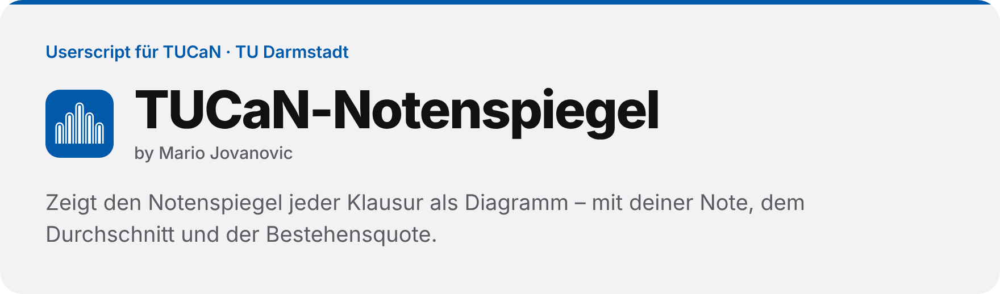
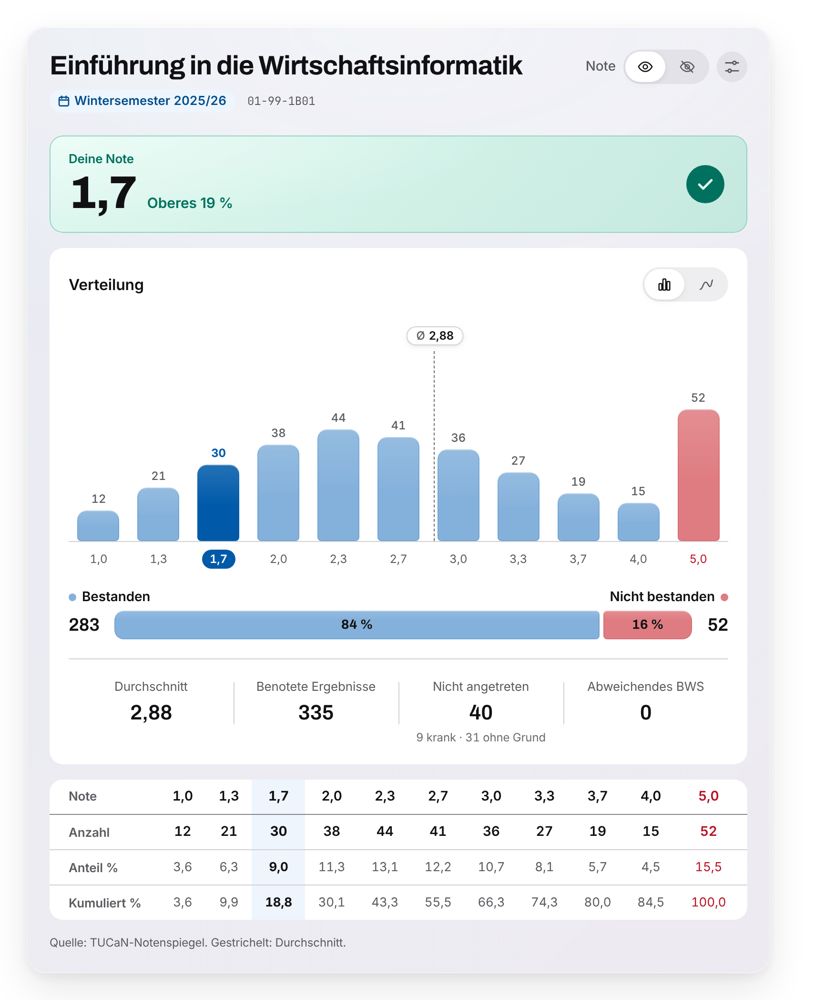
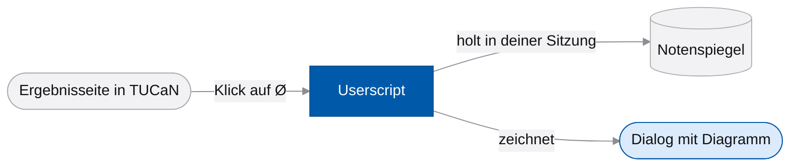

<picture>
  <source media="(prefers-color-scheme: dark)" srcset=".github/assets/banner-dark.png">
  
</picture>

<p>
  
  
  <a href="https://github.com/MarioJovc/tucan-notenspiegel/actions/workflows/pages.yml"></a>
  
</p>

Ein Userscript für TUCaN, das Campus-Management-System der TU Darmstadt. Klickst du bei deinen Modul- oder Prüfungsergebnissen auf das **Ø**, erscheint der Notenspiegel als Diagramm statt als Zahlentabelle: wo deine Note liegt, wie die Klausur insgesamt ausgefallen ist und wie viele bestanden haben. Das Skript läuft nur in deinem Browser und schickt nichts weg.

**Projektseite:** [mariojovc.github.io/tucan-notenspiegel](https://mariojovc.github.io/tucan-notenspiegel/) · **Demo:** [im Browser ansehen](https://mariojovc.github.io/tucan-notenspiegel/demo/) · **Installieren:** [tucan-notenspiegel.user.js](https://mariojovc.github.io/tucan-notenspiegel/tucan-notenspiegel.user.js)

<p align="center">
  <picture>
    <source media="(prefers-color-scheme: dark)" srcset="docs/assets/notenspiegel-dunkel.png">
    
  </picture>
</p>

## Funktionen

- **Deine Einordnung:** deine Note groß, dazu wie weit oben du liegst, etwa „Oberes 19 %“
- **Verteilung als Diagramm:** je Notenstufe als Balken oder als Linie, deine Stufe hervorgehoben, der Durchschnitt als Markierung
- **Bestanden und nicht bestanden** als Anteile, dazu Fehlende mit und ohne Krankschreibung und eine Tabelle mit Anteil und kumuliertem Anteil
- **Richtige Note je Ansicht:** Modulergebnisse zeigen die Modulnote, Prüfungsergebnisse die Note der einzelnen Prüfung
- **Note verbergen** für Screenshots, die du teilen willst
- **Hell, dunkel oder wie das System**, Balken auch per Tastatur erreichbar; fällt etwas aus, führt ein Knopf zur gewohnten Ansicht von TUCaN

## Installation

1. Installiere [Tampermonkey](https://www.tampermonkey.net/) für deinen Browser.
2. Nur in Chrome: Rechtsklick auf das Tampermonkey-Symbol → „Erweiterung verwalten“ → den Schalter für Benutzerskripts („Allow User Scripts“) einschalten. Tampermonkey erklärt das in seiner [FAQ](https://www.tampermonkey.net/faq.php?q=Q209).
3. Öffne [tucan-notenspiegel.user.js](https://mariojovc.github.io/tucan-notenspiegel/tucan-notenspiegel.user.js) und bestätige in Tampermonkey „Installieren“.

Neue Versionen holt Tampermonkey danach von selbst. Getestet ist das Skript mit Tampermonkey; andere Userscript-Erweiterungen können funktionieren.

## Nutzung

1. Öffne in TUCaN **Prüfungen → Modulergebnisse** oder **Prüfungsergebnisse**.
2. Klick in einer Zeile auf das **Ø**. Statt des Popups öffnet sich der Notenspiegel als Dialog.
3. Mit dem Augen-Schalter oben rechts blendest du deine Note aus. Die Einstellungen daneben wechseln zwischen Hell, Dunkel und System.

Ohne Installation kannst du alles in der [Demo](https://mariojovc.github.io/tucan-notenspiegel/demo/) ausprobieren, mit einer erfundenen Klausur und frei wählbarer Note.

## So funktioniert's



Die eigene Note liest das Skript aus der Zeile, in der du geklickt hast. Die Verteilung holt es von derselben Seite, die TUCaN sonst im Popup öffnet, ein Parser macht daraus Zahlen, und der Renderer stellt sie mit dem Design System TUDa UI dar. Gezeichnet wird in einem abgeschirmten Bereich der Seite (Shadow DOM) mit eingebettetem CSS und eingebetteten Schriften. Deshalb lädt das Skript nichts von fremden Servern und braucht in Tampermonkey keine Sonderrechte (`@grant none`).

## Deine Daten

- **Nur TUCaN:** Das Skript läuft ausschließlich auf `tucan.tu-darmstadt.de` und ruft dort nur den Notenspiegel ab.
- **Nichts nach außen:** Bei jedem Push prüfen die Tests, dass das Skript je Klick genau einen Abruf macht, nur beim Notenspiegel von TUCaN, und dass keine Anfrage an einen anderen Server geht.
- **Gebaut aus dem Quellcode:** Die Datei, die du installierst, baut der Workflow „Pages“ aus genau den Quellen in diesem Repo.
- **Gespeichert wird nur die Darstellung:** Hell, Dunkel oder System liegt im Browser unter `tuda-theme`.

Verbindlich sind die Angaben in TUCaN selbst; die Zahlen im Diagramm stammen von dort.

## Projektstruktur

```text
tucan-notenspiegel/
├── src/              Parser, Renderer und Anbindung an TUDa UI
├── userscript/       Kopf des Userscripts und Verbindung zu TUCaN
├── vendor/tuda-ui/   CSS und Schriften aus TUDa UI, unverändert
├── fixtures/         erfundene TUCaN-Seiten für Tests und Demo
├── tests/            Renderer- und Live-Tests, Testlauf ohne Fenster
├── demo/             Demo mit Fixture- und Notenwahl
├── docs/             Projektseite (GitHub Pages)
├── build.ps1         baut dist/tucan-skin.user.js
└── ENTWICKLUNG.md    Aufbau, Gestaltung, Tests und Fallen
```

## Entwicklung

| Aufgabe | Befehl |
|---|---|
| Userscript bauen | `powershell -ExecutionPolicy Bypass -File build.ps1` |
| Demo und Tests im Browser | `python -m http.server 8765`, dann `http://localhost:8765/demo/` und `/tests/` |
| Tests ohne Fenster | `npm install --no-save playwright`, `npx playwright install chromium`, `node tests/ausfuehren.mjs` |
| Neue Version veröffentlichen | `@version` in `userscript/header.txt` erhöhen und auf `main` pushen |

Der Workflow „Pages“ baut das Userscript auf Windows mit `build.ps1`, führt die Tests aus und stellt Skript, Projektseite und Demo auf GitHub Pages. Wie Parser, Renderer und Tests im Einzelnen arbeiten, steht in [ENTWICKLUNG.md](ENTWICKLUNG.md).

## Mitwirken

Fehler und Ideen gern als [Issue](https://github.com/MarioJovc/tucan-notenspiegel/issues/new/choose). Bitte lade dabei keine gespeicherten TUCaN-Seiten und keine Screenshots mit deinen Noten hoch; ein Ausschnitt mit erfundenen Zahlen reicht.

## Lizenz

Der Code steht unter der [MIT-Lizenz](LICENSE). Die eingebetteten Schriften Archivo und JetBrains Mono stehen unter der SIL Open Font License 1.1; die Lizenztexte liegen in [`lizenzen/`](lizenzen).

<br>

<p>
  
  <sub><b>TUCaN-Notenspiegel</b> · by Mario Jovanovic<br>Inoffiziell, kein Angebot der TU Darmstadt</sub>
</p>
